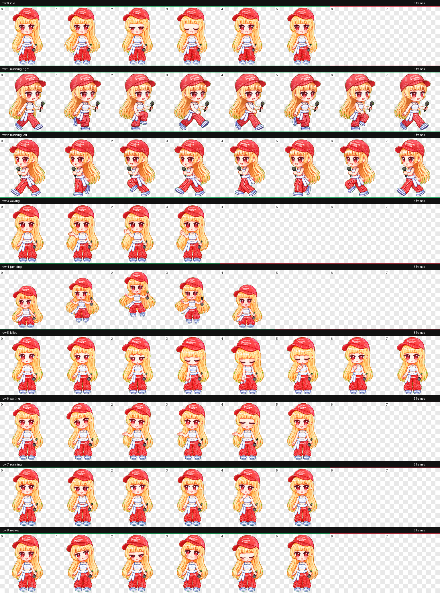

# 糕糕 · Gaogao Codex Pet

金发、红帽、手持话筒的糕糕，陪你完成编码、等待和复核任务。

这是适用于支持本地自定义宠物的 Codex 桌面客户端的动画资源包，包含九种状态。本分享版保留全部已验收动画，未重新绘制或修改。

## 下载与安装

- [下载 v1.0.0 ZIP 安装包](dist/gaogao-v1.0.0.zip)（在 GitHub 文件页点击下载原始文件）。
- [查看中文安装、更新与撤销说明](docs/INSTALL.md)。
- 发布者也可以将同一个 ZIP 附加到 GitHub Release，方便下载。

解压后，把 `gaogao` 文件夹放入 `%USERPROFILE%\.codex\pets\`，然后刷新或重启 Codex，选择“糕糕”。已有同名宠物请先备份。

## 完整动作总览



## 九组动画预览

| 待机 | 向右走 | 向左走 |
|---|---|---|
|  |  |  |

| 挥手 | 跳跃 | 失落 / 错误 |
|---|---|---|
|  |  |  |

| 等待用户输入 | 执行任务 / 工作 | 认真复核 |
|---|---|---|
|  |  |  |

## 格式与检查

- v1 精灵图：8 列 × 9 行，总尺寸 1536×1872，每格 192×208。
- WebP 无损、RGBA 透明背景，57 个有效帧、15 个全透明空格。
- 行顺序与帧数如下。`running` 是站定思考的工作状态，不是跑步。

|行号（0起）|状态|帧数|
|---:|---|---:|
|0|`idle`|6|
|1|`running-right`|8|
|2|`running-left`|8|
|3|`waving`|4|
|4|`jumping`|5|
|5|`failed`|8|
|6|`waiting`|6|
|7|`running`|6|
|8|`review`|6|

[自动检查摘要](docs/validation.json) · [文件 SHA256](SHA256SUMS.txt)

静态格式和文件一致性检查通过。实际显示效果依赖客户端版本；本包不宣称在所有版本上完成播放测试。跳跃为腾空预留空间，显示尺寸略小；挥手回落较快；深底可能可见极细绿色边缘，这些均保持已验收版本原样。

## 仓库内容

```text
Gaogao-Codex-Pet/
├── README.md
├── .gitignore
├── SHA256SUMS.txt
├── gaogao/                 # 可安装的两个文件
├── previews/               # 九组 GIF 与总览
├── docs/                   # 中文安装说明与检查摘要
└── dist/                   # ZIP 安装包
```

仅包含分享所需资源，不附带原始立绘、生成过程缓存、备份或开发环境记录。
